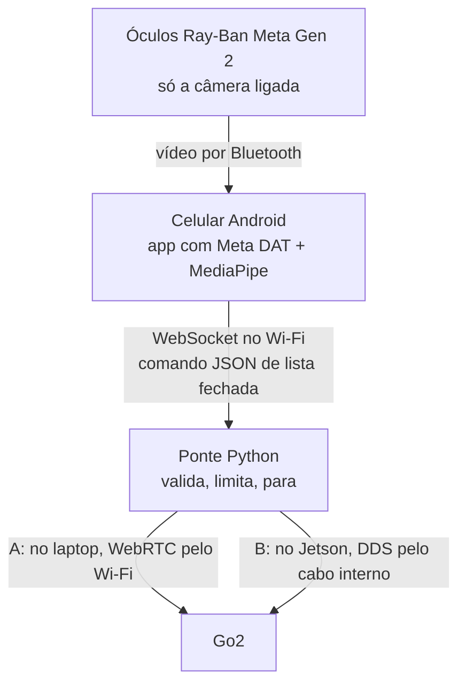

<h1 align="center">Meta Glasses × Unitree</h1>

  Controlar os robôs <b>Unitree Go2</b> e <b>G1 EDU</b> com gestos de mão vistos pela câmera dos óculos <b>Ray-Ban Meta Gen 2</b>.

  
  
  
  

---

## A ideia

Faço um gesto na frente dos óculos. O celular Android recebe o vídeo da câmera dos óculos, reconhece o gesto com MediaPipe e manda um comando para o robô.

- **Primeiro o Go2**, depois o G1.
- **Direto no robô real**, sem simulação. Para desenvolver sem o robô, a ponte tem um modo `mock`.

## Onde quero chegar

Apontar para um ponto no chão e o Go2 andar até lá. O projeto aberto [spectacles-dimensional-os](https://github.com/V4C38/spectacles-dimensional-os) já faz algo assim com óculos Snap Spectacles:

  
   
  GIF do projeto <a href="https://github.com/V4C38/spectacles-dimensional-os">spectacles-dimensional-os</a> (© 2026 spectacles-dimensional-os contributors, licença MIT). Não é deste repositório.

## Como funciona (esboço)

O caminho A (laptop + WebRTC) serve para começar logo; o B (Jetson + SDK oficial) é o destino final. Detalhes na [arquitetura](docs/arquitetura.md#dois-caminhos-até-o-robô).

## Estado

| Parte | Situação |
|---|---|
| Pesquisa de SDKs, rede do Go2 e projetos parecidos | Feita e conferida |
| Arquitetura e plano semanal | Escritos |
| Ponte WebSocket -> SDK Unitree | Escrita, testada só em modo mock |
| Backend WebRTC da ponte (caminho A) | Falta |
| Gesto pela webcam (no lugar dos óculos) | Escrito, não executado com webcam |
| App Android com o SDK dos óculos | Falta |
| Teste com óculos e robôs reais | Falta |

A ordem de trabalho, semana a semana, está no [plano](docs/plano.md#semanas).

## Documentação

| Documento | O que tem |
|---|---|
| [Plano](docs/plano.md) | Semanas com entregas, tarefas por esforço e valor, o que precisa do robô, fases e checkpoints |
| [Arquitetura](docs/arquitetura.md) | Como funciona: trechos e protocolos, os dois caminhos até o robô, Wi-Fi, segurança, diagramas |
| [Pesquisa](docs/pesquisa.md) | SDK dos óculos, comandos e simulação dos robôs, projetos parecidos |
| [MVP gesto](mvp-gesto/) | Ponte, cliente de teclado e gesto pela webcam |

## Principais descobertas

1. **Nenhum código roda nos óculos.** O app roda no celular e recebe o vídeo pelo [Meta Wearables DAT](https://github.com/facebook/meta-wearables-dat-android). O Meta AI é fechado, então o gesto é reconhecido no celular.
2. **No Android, câmera e microfone dos óculos juntos derrubam o vídeo** de ~15-17 fps para ~1-3 fps ([issue #159](https://github.com/facebook/meta-wearables-dat-android/issues/159)). O gesto usa só a câmera, então não é afetado.
3. **Os robôs têm comandos prontos** (`Move`, `StopMove`, `Sit`, `Hello`, `WaveHand`...) no [unitree_sdk2_python](https://github.com/unitreerobotics/unitree_sdk2_python).
4. **Esses comandos não existem no simulador**, e não há política de locomoção pronta para o Go2. Por isso os testes vão direto no robô real ([pesquisa](docs/pesquisa.md#simulação)).
5. **O Jetson do Go2 EDU não tem Wi-Fi.** Para o celular falar com ele é preciso um adaptador USB; a alternativa é WebRTC pelo Wi-Fi do próprio robô, via laptop ([arquitetura](docs/arquitetura.md#dois-caminhos-até-o-robô)).
6. **O SDK dos óculos 1.0 foi anunciado em 24/09/2026** ([Meta](https://developers.meta.com/blog/meta-connect-recap-ai-glasses/)), com fala, movimento da cabeça e "Hey Meta" para abrir apps. No GitHub a última versão publicada ainda é a 0.9.0.

## Links principais

**Óculos**
- [meta-wearables-dat-android](https://github.com/facebook/meta-wearables-dat-android) · [meta-wearables-dat-ios](https://github.com/facebook/meta-wearables-dat-ios)
- [Mock Device Kit](https://wearables.developer.meta.com/docs/develop/dat/mock-device-kit/) · [FAQ](https://developers.meta.com/wearables/faq/)
- [MediaPipe Gesture Recognizer](https://developers.google.com/edge/mediapipe/solutions/vision/gesture_recognizer)

**Robôs**
- [unitree_sdk2_python](https://github.com/unitreerobotics/unitree_sdk2_python) · [unitree_ros2](https://github.com/unitreerobotics/unitree_ros2)
- [unitree_mujoco](https://github.com/unitreerobotics/unitree_mujoco) · [unitree_sim_isaaclab](https://github.com/unitreerobotics/unitree_sim_isaaclab)
- [unitree_rl_gym](https://github.com/unitreerobotics/unitree_rl_gym) · [unitree_rl_lab](https://github.com/unitreerobotics/unitree_rl_lab) · [unitree_rl_mjlab](https://github.com/unitreerobotics/unitree_rl_mjlab)

**Referências**
- [spectacles-dimensional-os](https://github.com/V4C38/spectacles-dimensional-os) · [Dimensional OS](https://github.com/dimensionalOS/dimos)
- [Unitree-Go2-GestureDetection](https://github.com/lez666/Unitree-Go2-GestureDetection) · [xr_teleoperate](https://github.com/unitreerobotics/xr_teleoperate)

## Segurança

Nos testes com robô real: controle físico na mão de outra pessoa, lista fechada de comandos, parada automática se o celular cair ou o heartbeat parar, G1 no pórtico e nunca `Damp` no G1 (ele cai). Detalhes em [docs/arquitetura.md](docs/arquitetura.md#segurança).
