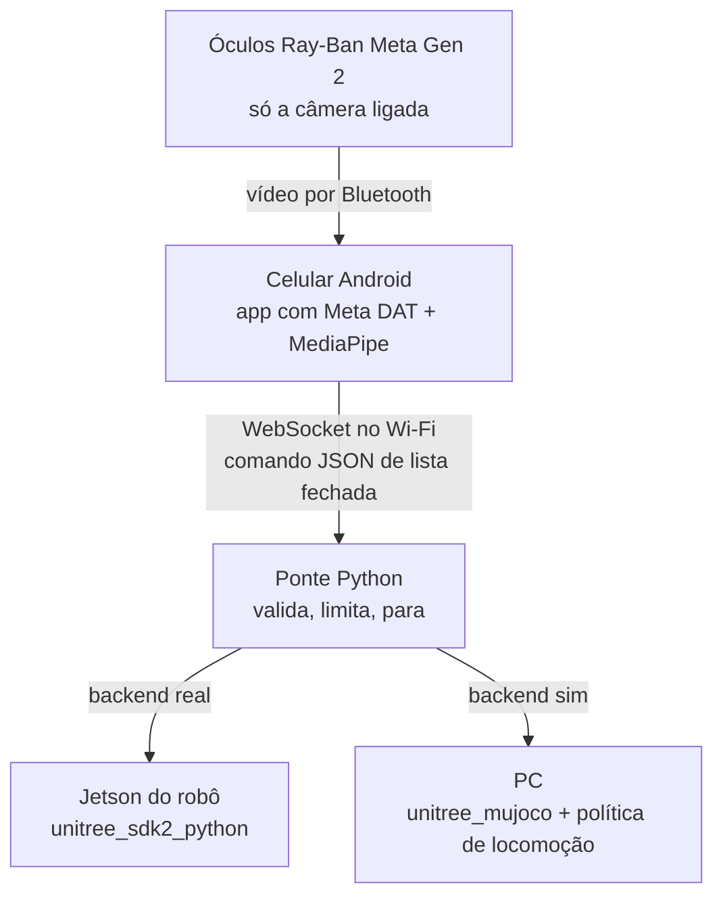

# Arquitetura

> Como o gesto sai da mão e chega no robô. Atualizado em 28/09/2026.

## Objetivo

Faço um gesto com a mão na frente dos óculos. A câmera dos óculos vê a mão, um modelo de visão no celular Android reconhece o gesto e o robô executa uma ação.

- **Primeiro o Go2**, depois o G1.
- **Primeiro na simulação**, depois no robô real, com o mesmo código.

## Fluxo

O app e o protocolo são os mesmos nos dois casos. Só muda o backend da ponte.

## Por que cada peça está onde está

| Decisão | Motivo |
|---|---|
| Gesto reconhecido **no celular** | Os óculos não rodam código e o Meta AI é fechado ([detalhes](oculos-meta.md)) |
| **Só a câmera** ligada | No Android, câmera + microfone dos óculos derrubam o vídeo para ~1 a 3 fps ([issue #159](https://github.com/facebook/meta-wearables-dat-android/issues/159)) |
| **Android** | Mais configurável e roda os modelos localmente |
| Ponte **no Jetson do robô** | O SDK da Unitree fala DDS na rede interna do robô ([detalhes](robos-unitree.md)) |
| Backend **sim** separado | O simulador não tem os comandos prontos do robô real; precisa de política de locomoção |

## Reconhecimento do gesto

- **Agora:** MediaPipe Gesture Recognizer, 7 gestos prontos, em modo `LIVE_STREAM`.
- **Depois:** gestos próprios, treinando um classificador com o Model Maker.
- **Contra disparo acidental:** confiança mínima, gesto parado ~0,5 s antes de valer, e mão aberta = parar, com prioridade.
- A lógica de referência está em [`mvp-gesto/gesto_webcam.py`](../mvp-gesto/gesto_webcam.py), com a webcam no lugar dos óculos.

## Segurança

| Regra | Onde está |
|---|---|
| Controle físico do robô na mão de outra pessoa, com prioridade sobre tudo | Procedimento de teste |
| Só uma lista fechada de comandos é aceita | `ponte.py` |
| Sem heartbeat do celular por 300 ms -> `StopMove` | `ponte.py` |
| Celular desconectou -> `StopMove` | `ponte.py` |
| "Parar" passa na frente de tudo, sem cooldown | `ponte.py` |
| No G1, nunca `Damp` (ele cai) | `ponte.py` |
| Todo comando de movimento expira e precisa ser renovado | Planejado |
| Velocidade limitada na ponte | Planejado |
| G1 no pórtico nos primeiros testes | Procedimento de teste |
| DDS domain id 1 no simulador e 0 no robô real | Planejado (backend sim) |

## O que falta

Pronto hoje: esta arquitetura e o [`mvp-gesto/`](../mvp-gesto/) (ponte, cliente de teclado, gesto pela webcam). A ponte só foi testada em modo `mock`, que confere o protocolo e as regras de parada, mas não move robô nenhum.

### 1. Política de locomoção do Go2 (trava o resto)

**O que é:** uma rede treinada que recebe o estado do robô (ângulos e velocidades das 12 juntas, orientação do corpo) e o comando "ande a X m/s, gire a Y", e devolve várias vezes por segundo a posição-alvo de cada um dos 12 motores.

**Por que o projeto depende dela:**
- No **Go2 real**, o controlador de locomoção da Unitree já roda dentro do robô. A ponte manda `Move(vx, vy, giro)` e ele anda.
- No **simulador** (`unitree_mujoco`) esse controlador não existe. Só há comando motor a motor, então `Move`, `Sit` e `Hello` não fazem nada. Sem política, o Go2 simulado não anda.
- O plano é testar tudo na simulação antes do robô real. Sem a política, não dá para ver um gesto virar movimento.
- A Unitree não publica política pronta para o Go2 ([conferido](robos-unitree.md#a-solução-política-de-locomoção)). A saída é uma política própria já treinada.

**O que precisa estar documentado da política para ligar na ponte:**
- Arquivo e formato (`.pt`, `.onnx` ou pasta do `unitree_rl_gym` / `unitree_rl_lab` / `unitree_rl_mjlab`).
- Onde foi treinada (define a ordem das juntas e as convenções).
- Entradas: quais sinais, ordem, escalas, se usa histórico.
- Saídas: escala da ação, posição padrão das juntas, ganhos kp/kd.
- Frequência de controle (ex.: 50 Hz).

**Mesmo com a política:** truques do robô real, como dar a pata (`Hello`) ou sentar (`Sit`), não existem na simulação. Lá só dá para testar andar, virar e parar.

### 2. O resto

| Item | Situação |
|---|---|
| Backend `sim` da ponte | Não escrito; depende do item 1 |
| App Android com o DAT | Não começado; dá para começar sem os óculos com o MockDeviceKit |
| Óculos e robô reais | Nada rodou em hardware. As classes Go2 e G1 da ponte seguem os exemplos oficiais do SDK, mas não foram executadas num robô |
| G1 na simulação | Tem política pronta do G1 no `unitree_rl_gym` |

## Ordem de trabalho

1. **Simulação do Go2:** `unitree_mujoco` + política própria, ponte com backend sim, comandos de `teclado.py` e depois de `gesto_webcam.py`.
2. **App Android:** app de exemplo do `meta-wearables-dat-android` com MockDeviceKit (vídeos de gestos gravados em H.265), MediaPipe em cada frame, envio para a ponte.
3. **Óculos reais:** trocar o mock pelos óculos e medir a latência gesto -> robô.
4. **Go2 real:** a mesma ponte com backend real no Jetson.
5. **G1:** simulação, depois o real no pórtico.

## Ainda precisa medir

- A latência real óculos -> celular e o total gesto -> robô. Esse número decide se o gesto serve só para comandos discretos ou também para movimento contínuo.
- Quão bem o MediaPipe reconhece a mão em primeira pessoa (vista de trás, cortada na borda).

## Depois

### Voz

Serve para validar o ciclo comando -> robô responde, tudo via óculos e celular. No Android o microfone dos óculos derruba o vídeo, então os caminhos a testar são:

- Áudio dentro do stream da câmera (beta no SDK, sem HFP).
- Microfone do próprio celular.
- Alternar entre modo voz e modo gesto.

O reconhecimento de fala seria local no celular, mandando os mesmos comandos JSON para a ponte.

### Apontar e o Go2 ir até lá

Falta:
1. Localizar o robô na câmera dos óculos (marcador nas costas).
2. Converter o apontar em um ponto no chão, relativo ao robô.
3. Controle em malha fechada até o alvo.

Referência: [spectacles-dimensional-os](projetos-relacionados.md#spectacles-dimensional-os-mit), que faz isso com Snap Spectacles e Go2.
