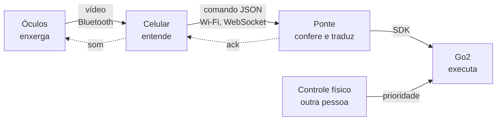
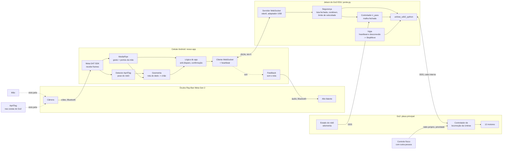
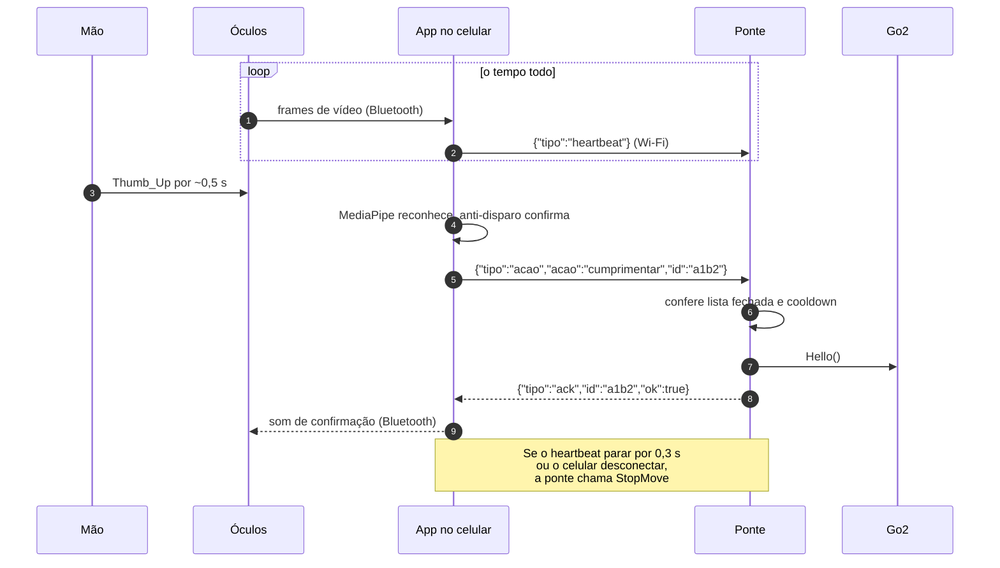

# Arquitetura

> Como o gesto sai da mão e chega no robô, do jeito que está pensado hoje. Atualizado em 12/10/2026. **Nada rodou em hardware ainda**; a ponte só foi testada em modo `mock`.

## Objetivo

Faço um gesto com a mão na frente dos óculos. A câmera dos óculos vê a mão, um modelo de visão no celular Android reconhece o gesto e o robô executa uma ação. Depois: apontar para um ponto no chão e o Go2 ir até lá.

- **Primeiro o Go2**, depois o G1.
- **Testes direto no robô real**, sem simulação. No Go2 real o controlador de locomoção da Unitree já anda com `Move(vx, vy, giro)`; no simulador seria preciso treinar uma política própria ([pesquisa](pesquisa.md#simulação)).

## Visão geral



O vídeo **para no celular**. Para o robô só vão mensagens pequenas de texto, então o Wi-Fi não é o gargalo.

## Os três trechos

| Trecho | Meio | Protocolo | O que passa |
|---|---|---|---|
| Óculos -> celular | Bluetooth | Meta Wearables DAT | Vídeo da câmera (360p a 720p, ~15-17 fps no Android) |
| Celular -> ponte | Wi-Fi | WebSocket + JSON | Comandos de lista fechada, heartbeat, `ack` de volta |
| Ponte -> robô | Depende do caminho (abaixo) | WebRTC ou DDS | `Move`, `StopMove`, `Hello`... e estado do robô |

Protocolo entre celular e ponte (definido em [`ponte.py`](../mvp-gesto/ponte.py)):

```
{"tipo": "acao", "acao": "cumprimentar", "id": "abc123"}
{"tipo": "acao", "acao": "parar"}
{"tipo": "heartbeat"}
resposta: {"tipo": "ack", "id": "abc123", "ok": true, "acao": "cumprimentar"}
```

## Dois caminhos até o robô

A ponte troca de backend com uma opção na linha de comando. Celular, gestos e protocolo são os mesmos nos dois.

| | A. Laptop + WebRTC | B. Jetson + SDK oficial |
|---|---|---|
| Rota | Celular -> Wi-Fi -> laptop (`ponte.py --robo go2-webrtc`) -> Wi-Fi, WebRTC -> Go2 | Celular -> Wi-Fi -> Jetson (`ponte.py --robo go2`) -> cabo interno, DDS -> Go2 |
| Peça extra | Nenhuma | Adaptador Wi-Fi USB no Jetson |
| Situação | Um amigo já teleoperou um Go2 EDU assim, pelo terminal | Nada testado ainda |
| Onde fica a ponte | No laptop, fora do robô | No robô |
| Se a ponte cair | A testar: o robô para sozinho? | O vigia fica no robô e para |
| Firmware novo | Pode quebrar (a 1.1.15 passou a exigir chave AES) | Não afeta |
| Suporte | Comunidade (engenharia reversa) | Oficial da Unitree |

**Decisão:** começar pelo **A** para mover o robô logo; o **B** é o destino final. O caminho A é o mesmo do [vídeo de referência](pesquisa.md#como-a-comunicação-acontece), com o laptop no lugar do Mac.

## Rede Wi-Fi do caminho B

Pesquisado em 08/10/2026:

- O Jetson do Go2 EDU **não vem com Wi-Fi**. O suporte da MYBOTSHOP: "The Orin in the GO2 generally doesn't have a WiFi module installed, and it is recommended to use a dongle" ([fórum](https://forum.mybotshop.de/t/unitree-go2-edu-jetson-wifi-issue/1314)).
- O modelo base **não tem roteador interno**. A rede `192.168.123.x` liga só o Jetson (`.18`) e a placa do robô (`.161`) ([fórum](https://forum.mybotshop.de/t/unitree-go2-edu-cant-reach-jetson/1630), [docs MYBOTSHOP](https://www.docs.mybotshop.de/go2.html)).
- O Wi-Fi do próprio Go2 (o do app da Unitree) é da placa do robô. Não achei indicação de que ele alcance o Jetson.
- Outros grupos usam um adaptador USB no Jetson: Southampton cria uma rede própria ([Southampton](https://www.robots.ecs.soton.ac.uk/go2/ros_control/)); a MYBOTSHOP conecta o Jetson ao Wi-Fi do laboratório ([fórum](https://forum.mybotshop.de/t/unitree-go2-edu-wireless-connection/1292)).

**Como montar:**

1. **Adaptador Wi-Fi USB no Jetson**, conectado antes de ligar o robô. O TP-Link TL-WN722N funciona sem driver extra, segundo a MYBOTSHOP, mas só tem 2,4 GHz. Um de 5 GHz evita disputar a faixa com o Bluetooth dos óculos, mas o driver depende da versão do JetPack ([fórum NVIDIA](https://forums.developer.nvidia.com/t/jetpack-5-x-wifi-drivers-in-kernel/273466)).
2. **Jetson entra no roteador do projeto** com `sudo nmtui`, por SSH no cabo (`ssh unitree@192.168.123.18`).
3. **IP fixo** reservado no roteador. O app conecta em `ws://<ip-wifi-do-jetson>:8765`. (Os exemplos com `192.168.123.18` só valem pelo cabo.)
4. **Teste com o laptop antes do app:** `teclado.py` no mesmo Wi-Fi, ponte em `--robo mock` e depois `--robo go2`.

O DDS continua só no cabo (`eth0`, como `ponte.py` já faz). Pelo Wi-Fi passa só o WebSocket, então não é preciso reconfigurar o DDS para a rede sem fio.

| Opção | Como | Quando usar |
|---|---|---|
| **Roteador do projeto** (recomendado) | Jetson (pelo adaptador) e celular no mesmo roteador, com senha | Desenvolvimento; o laptop também entra |
| Hotspot no Jetson | O adaptador cria a rede, como em Southampton | Demonstração fora do laboratório |
| Wi-Fi do próprio Go2 | Rede do app da Unitree, ligada à placa do robô | Não serve para a ponte |

**Cuidados:** não usar a rede da instituição (costuma bloquear um aparelho de falar com outro); qualquer aparelho na rede pode mover o robô, então senha só do projeto e, depois, um token na ponte; trocar a senha padrão do Jetson (`unitree/123`).

## Por que cada peça está onde está

| Decisão | Motivo |
|---|---|
| Gesto reconhecido **no celular** | Os óculos não rodam código e o Meta AI é fechado ([pesquisa](pesquisa.md#óculos-ray-ban-meta-gen-2)) |
| **Só a câmera** dos óculos ligada | No Android, câmera + microfone dos óculos derrubam o vídeo para ~1 a 3 fps ([issue #159](https://github.com/facebook/meta-wearables-dat-android/issues/159)) |
| **Android** | Mais configurável e roda os modelos localmente |
| Ponte separada do celular | É ela que para o robô quando o celular some; no caminho B fica dentro do robô, que é o único lugar com acesso ao DDS |
| App em Kotlin, ponte em Python | O app substitui o `gesto_webcam.py`; a ponte continua em Python porque usa o `unitree_sdk2_python` |

## Reconhecimento do gesto

- **Agora:** MediaPipe Gesture Recognizer, 7 gestos prontos, em modo `LIVE_STREAM`.
- **Depois:** gestos próprios, treinando um classificador com o Model Maker.
- **Contra disparo acidental:** confiança mínima, gesto parado ~0,5 s antes de valer, baixar a mão para repetir, e mão aberta = parar, com prioridade.
- A lógica de referência está em [`gesto_webcam.py`](../mvp-gesto/gesto_webcam.py), com a webcam no lugar dos óculos.

## Apontar e o Go2 ir até lá

Uma AprilTag (marcador impresso que a câmera localiza em 3D) vai nas costas do Go2. A câmera vê a tag e o dedo no mesmo quadro. Uma reta sai da câmera, passa pela ponta do dedo e cruza o chão; o ponto de encontro, no referencial da tag, é o alvo. A ponte recebe `{"tipo":"ir_para","x":..,"y":..}` e leva o robô até lá em malha fechada pela odometria.

O marcador AR flutuante do vídeo de referência não se reproduz: o Ray-Ban Meta Gen 2 não tem tela nem rastreamento de mão.

## Segurança

| Regra | Onde está |
|---|---|
| Controle físico do robô na mão de outra pessoa, com prioridade sobre tudo | Procedimento de teste |
| Só uma lista fechada de comandos é aceita | `ponte.py` |
| Sem heartbeat do celular por 300 ms -> `StopMove` | `ponte.py` |
| Celular desconectou -> `StopMove` | `ponte.py` |
| "Parar" passa na frente de tudo, sem cooldown | `ponte.py` |
| No G1, nunca `Damp` (ele cai) | `ponte.py` |
| Todo comando de movimento expira e precisa ser renovado | Planejado |
| Velocidade limitada na ponte | Planejado |
| G1 no pórtico nos primeiros testes | Procedimento de teste |

## Diagrama detalhado

Fluxo final com gestos e apontar, no caminho B.



## Uma mensagem do começo ao fim



## Ainda precisa medir

- **Latência** óculos -> celular e o total gesto -> robô. Decide se o gesto serve só para comandos discretos ou também para movimento contínuo. Ela se acumula, na ordem: Bluetooth dos óculos (provavelmente a maior parte), MediaPipe mais os ~0,5 s de gesto parado (de propósito), Wi-Fi (milissegundos) e o tempo do robô começar a se mexer.
- **Reconhecimento em primeira pessoa:** quão bem o MediaPipe vê a mão vista de trás e cortada na borda.
- **Caminho A:** o que o Go2 faz quando a ponte cai no meio de um movimento.

## Depois: voz

Serve para validar o ciclo comando -> robô responde, tudo via óculos e celular. No Android o microfone dos óculos derruba o vídeo, então os caminhos a testar são: áudio dentro do stream da câmera (beta no SDK, sem HFP), microfone do próprio celular, ou alternar entre modo voz e modo gesto. O reconhecimento de fala seria local no celular, mandando os mesmos comandos JSON para a ponte.
