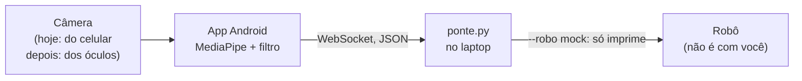

# Guia: app Android de gestos

> Para quem entra no projeto para fazer o app do celular. Atualizado em 16/10/2026. É a semana 4 do [plano](plano.md#semanas), adiantada para rodar em paralelo com o trabalho nos óculos. Esforço estimado: 1 a 2 semanas.

## Em uma frase

Um app Android que olha pela câmera, reconhece gestos de mão com o MediaPipe e manda comandos JSON por WebSocket para a **ponte**, um programa Python que já existe e que fala com o robô.

## Onde o app se encaixa



**Você não precisa saber nada de robótica.** A ponte esconde o robô: recebe `{"acao":"cumprimentar"}` e decide se e como executar. Durante todo o seu trabalho a ponte roda em modo `mock`, que só imprime o que o robô faria. Ligar no robô de verdade acontece nas sessões com o robô, com uma segunda pessoa segurando o controle físico. Nunca conecte o app a uma ponte com robô real sem combinar antes.

**Os óculos também não são com você agora.** Quem está nos óculos (Meta DAT SDK) vai fazer o vídeo deles chegar no celular. Seu app usa a câmera do próprio celular, com a fonte de frames isolada atrás de uma interface, para a troca pelos óculos ser só uma classe nova.

## Primeiro dia

1. **Acesso ao repositório.** Peça para ser adicionado como colaborador em https://github.com/Lucas-byte123/Meta-Unitree-Lucas.
2. **Clonar.** O código ainda está num branch, até o PR entrar no `main`:
   ```
   git clone https://github.com/Lucas-byte123/Meta-Unitree-Lucas.git
   cd Meta-Unitree-Lucas
   git checkout docs/plano-semanal
   ```
3. **Rodar a versão Python do que você vai construir.** Precisa de Python 3.11 (o MediaPipe ainda não tem versão para o 3.14):
   ```
   cd mvp-gesto
   python3.11 -m venv .venv
   source .venv/bin/activate
   pip install -r requirements.txt
   python -m unittest              # 27 testes, ~3 s
   ```
   Depois, em dois terminais (os dois em `mvp-gesto/` com o `source .venv/bin/activate`):
   ```
   python ponte.py --robo mock     # terminal 1
   python gesto_webcam.py          # terminal 2: abre a webcam
   ```
   Faça 👍, ✌️, ☝️ e ✋ na frente da webcam e veja a ponte responder no terminal 1. **O app é este `gesto_webcam.py` reescrito em Kotlin.**
4. **Ler, nesta ordem:**
   - [`AGENTS.md`](../AGENTS.md): regras e convenções do repositório. Seu assistente de código (Claude Code, Codex, Cursor) já lê este arquivo sozinho.
   - [`mvp-gesto/README.md`](../mvp-gesto/README.md): gestos, ações e roteiro de teste.
   - [`mvp-gesto/filtro.py`](../mvp-gesto/filtro.py) e [`tests/test_filtro.py`](../mvp-gesto/tests/test_filtro.py): a lógica que você vai portar, com os testes.
   - [`mvp-gesto/gesto_webcam.py`](../mvp-gesto/gesto_webcam.py): MediaPipe, heartbeat e leitura das respostas.
   - O começo de [`mvp-gesto/ponte.py`](../mvp-gesto/ponte.py): o protocolo, no comentário do topo.
   - [Arquitetura](arquitetura.md), seções "Visão geral", "Os três trechos" e "Segurança". O resto é contexto de robô.

## O que construir

### Escopo

| Entra | Fica de fora (por enquanto) |
|---|---|
| Câmera do celular (CameraX) | Óculos e Meta DAT SDK |
| MediaPipe Gesture Recognizer em `LIVE_STREAM` | Gestos novos ou modelo treinado |
| Filtro anti-disparo igual ao `filtro.py` | Apontar e AprilTag (próxima etapa, abaixo) |
| Cliente WebSocket com heartbeat e leitura dos `ack` | Comando de velocidade livre (`mover`) |
| Tela com gesto, confiança, progresso, resposta da ponte e botão PARAR | Voz, LLM, agentes |
| Campo editável com o endereço da ponte e escolha do mapa (go2/g1) | iOS |

### Estrutura sugerida

Separar em peças que dá para testar sozinhas:

| Peça | O que faz | Equivalente no Python |
|---|---|---|
| `FonteDeFrames` (interface) | Entrega frames (`Bitmap` + horário em ms) | `cv2.VideoCapture` |
| `CameraCelular` | Implementa a interface com CameraX | webcam |
| `ReconhecedorGesto` | MediaPipe em `LIVE_STREAM` -> (gesto, confiança) | `recognize_for_video` |
| `FiltroGesto` | (gesto, confiança, t_ms) -> ação ou null | `filtro.py` |
| `ClientePonte` | WebSocket, heartbeat, envio de ação, leitura de `ack`, estado da conexão | `websockets` em `gesto_webcam.py` |
| Tela | Mostra tudo e tem o botão PARAR | `desenhar()` |

```kotlin
interface FonteDeFrames {
    fun iniciar(aoChegarFrame: (bitmap: Bitmap, tMs: Long) -> Unit)
    fun parar()
}
```

Quando os óculos estiverem funcionando, entra uma `CameraOculos : FonteDeFrames` e o resto do app não muda.

### Regras que precisam ser iguais às do Python

| Regra | Valor |
|---|---|
| Confiança mínima (abaixo disso = sem gesto) | 0,7 |
| Gesto estável antes de valer | 500 ms |
| Estável antes de valer, para `parar` | 200 ms |
| Depois de disparar | o mesmo gesto só vale de novo depois de baixar a mão ou trocar de gesto |
| Categoria `"None"` do MediaPipe | mão sem gesto conhecido = sem gesto |
| Heartbeat | a cada 100 ms |

Mapas de gesto -> ação (nomes das categorias do MediaPipe):

| Gesto | `go2` | `g1` |
|---|---|---|
| `Thumb_Up` | `cumprimentar` | `cumprimentar` |
| `Victory` | `sentar` | `high_five` |
| `Pointing_Up` | `levantar` | |
| `ILoveYou` | | `palmas` |
| `Open_Palm` | `parar` | `parar` |

### Protocolo com a ponte

Uma mensagem JSON por frame WebSocket, na porta 8765:

```
app -> ponte   {"tipo": "heartbeat"}                                    a cada 100 ms
app -> ponte   {"tipo": "acao", "acao": "cumprimentar", "id": "a1b2c3d4"}
ponte -> app   {"tipo": "ack", "id": "a1b2c3d4", "ok": true, "acao": "cumprimentar"}
ponte -> app   {"tipo": "ack", "id": "...", "ok": false, "erro": "ocupado"}
```

Erros que a ponte devolve e que a tela deve mostrar: `ocupado` (outro truque há menos de 3 s), `em movimento`, `ação não permitida: ...`, `JSON inválido`. O heartbeat não tem resposta.

**O que a ponte faz por segurança, e o app precisa respeitar:** se ficar 300 ms sem heartbeat, ou se a conexão cair, ela manda o robô parar. Então:

- **Mande o heartbeat a partir do processamento dos frames, não de um timer solto.** Se a câmera ou o MediaPipe travar, o heartbeat para junto e o robô para. É o que o `gesto_webcam.py` faz: o heartbeat sai de dentro do loop de frames.
- **Feche o WebSocket em `onStop`.** App em segundo plano não pode continuar mandando comando.
- **Botão PARAR grande e sempre visível**, que manda `{"tipo":"acao","acao":"parar"}` sem depender de gesto.
- Só mande ações do mapa escolhido.

## Pegadinhas conhecidas

- **`ws://` sem TLS é bloqueado por padrão no Android.** Para desenvolvimento, `android:usesCleartextTraffic="true"` no manifest ou um `network_security_config`.
- **Endereço da ponte:** no celular de verdade, o IP do laptop no Wi-Fi (no Mac: `ipconfig getifaddr en0`), por exemplo `ws://192.168.0.42:8765`. No emulador, `ws://10.0.2.2:8765`.
- **Celular e laptop na mesma rede.** Redes de instituição costumam bloquear um aparelho de falar com outro; se não conectar, teste no hotspot do celular ou num roteador próprio. O firewall do macOS também pode perguntar se o Python aceita conexões.
- **`LIVE_STREAM` exige horários sempre crescentes** e devolve o resultado em outra thread, num callback. Use o horário do frame no filtro, não o horário do callback.
- **Rotação:** o `ImageProxy` do CameraX vem com `rotationDegrees`; gire o bitmap (ou passe a rotação ao MediaPipe), senão a mão chega deitada e o reconhecimento cai.
- **Desempenho:** análise em 640x480 com `STRATEGY_KEEP_ONLY_LATEST` basta. Os óculos vão entregar ~15 fps, então não precisa de mais que isso.
- **Simular a visão dos óculos:** use a **câmera traseira** apontada para a frente, com a sua mão na frente dela, como se o celular fosse seus olhos. A câmera frontal (você de frente para a tela) é útil para depurar, mas não é o ângulo real.
- **Callbacks do OkHttp rodam fora da thread de UI.** Atualize a tela com `runOnUiThread`, ou com um `StateFlow` observado pela tela.

## Como testar

**Testes de unidade (JUnit):** portar os casos de [`tests/test_filtro.py`](../mvp-gesto/tests/test_filtro.py): dispara depois de estável, não dispara antes, confiança baixa não conta, não repete sem baixar a mão, repete depois de baixar, tremida reinicia a contagem, `parar` é mais rápido, gesto fora do mapa não dispara, trocar de gesto dispara o novo, progresso.

**Contra a ponte em `mock`:** a ponte no laptop (`python ponte.py --robo mock`), o app no celular no mesmo Wi-Fi. O terminal da ponte mostra cada mensagem: `[mock] executaria: cumprimentar`, `cliente desconectado -> parar`, `heartbeat perdido -> parar`.

## Pronto quando

- [ ] Testes do filtro passando.
- [ ] Cada gesto do mapa `go2` dispara a ação certa na ponte em pelo menos 9 de 10 tentativas, com a câmera traseira.
- [ ] Segurar o gesto não repete; baixar a mão e repetir dispara de novo.
- [ ] ✋ dispara `parar` em ~0,2 s, e o botão PARAR funciona sem gesto.
- [ ] Recusas da ponte (`ocupado`) aparecem na tela.
- [ ] Mandar o app para segundo plano -> a ponte mostra `cliente desconectado -> parar`.
- [ ] Tampar a câmera não derruba a conexão (frames escuros continuam chegando e mantêm o heartbeat).
- [ ] Desligar o Wi-Fi do celular -> a ponte mostra `heartbeat perdido -> parar` ou `cliente desconectado -> parar`.
- [ ] 5 minutos com o celular apontado para a frente enquanto você mexe as mãos normalmente (digitando, falando) sem nenhuma ação disparada.
- [ ] Vídeo curto: gesto na câmera do celular -> comando aparecendo na ponte. É a entrega do report semanal.

## Depois disso

Em ordem provável:

1. **Trocar a câmera pelos óculos**, junto com quem fez o stream do DAT funcionar: implementar `CameraOculos : FonteDeFrames` e medir fps e reconhecimento em primeira pessoa.
2. **Apontar** (semanas 6–7 do plano, [F3](plano.md#f3-apontar-pela-webcam--apriltag---go2)): com uma AprilTag nas costas do robô, calcular o ponto do chão para onde o dedo aponta e mandar `{"tipo":"ir_para","x":..,"y":..}`. É visão computacional e geometria (calibração de câmera, pose da tag, reta cruzando o plano do chão). Pela arquitetura, essa conta vai rodar no celular, dentro deste app.
3. **Som de confirmação** no alto-falante dos óculos quando chegar o `ack`.

## Referências

**MediaPipe (reconhecer o gesto)**
- [Gesture Recognizer: visão geral](https://ai.google.dev/edge/mediapipe/solutions/vision/gesture_recognizer)
- [Gesture Recognizer: guia Android](https://ai.google.dev/edge/mediapipe/solutions/vision/gesture_recognizer/android)
- [Exemplo oficial Android](https://github.com/google-ai-edge/mediapipe-samples/tree/main/examples/gesture_recognizer/android): CameraX + `LIVE_STREAM` prontos, um bom ponto de partida para copiar
- Modelo: o mesmo `gesture_recognizer.task` do Python, que vai em `assets/` ([download](https://storage.googleapis.com/mediapipe-models/gesture_recognizer/gesture_recognizer/float16/1/gesture_recognizer.task))

**Android**
- [CameraX: análise de imagem](https://developer.android.com/media/camera/camerax/analyze)
- [OkHttp](https://github.com/square/okhttp): cliente WebSocket (`OkHttpClient().newWebSocket(...)`)
- [Tráfego sem TLS (network security config)](https://developer.android.com/privacy-and-security/security-config)

**Óculos (para conhecer, não para usar agora)**
- [meta-wearables-dat-android](https://github.com/facebook/meta-wearables-dat-android): SDK e app de exemplo
- [Pesquisa do projeto sobre os óculos](pesquisa.md): fps, resoluções, limitações no Android

## Como entregar

- Código numa pasta `app-android/` na raiz do repositório, num branch próprio (`app-android`), com PR para o `main`.
- Uma vez por semana, um report curto no [modelo do plano](plano.md#modelo-de-report-semanal).
- Mudança em `ponte.py` (protocolo, parada, limites) passa por quem cuida do robô antes de entrar.
