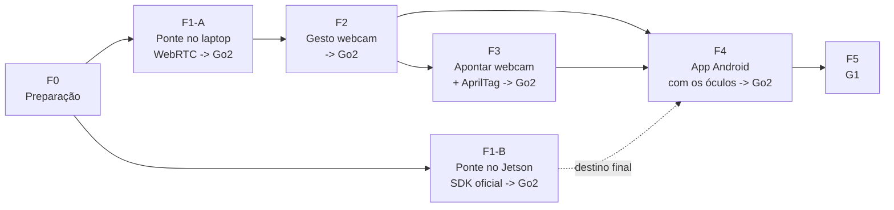

# Plano

> Atualizado em 29/10/2026 (versão anterior: 12/10/2026). Testes direto no Go2 real, sem simulação, começando pelo caminho A (laptop + WebRTC) e com o caminho B (Jetson + SDK oficial) como destino final ([arquitetura](arquitetura.md#dois-caminhos-até-o-robô)). Uma entrega por semana. Esforços e metas dos checkpoints são estimativas.

## Como trabalhar

- **Quase tudo dá para fazer sem o robô.** O robô entra só para integrar: ligar o que já está pronto e medir.
- **Sessão com o robô é cara.** Precisa do Go2 disponível, de espaço livre e de **uma segunda pessoa com o controle físico** (regra de [segurança](#segurança-em-todos-os-testes-com-robô)). Então tudo que vai ser testado no robô chega pronto e testado em `mock`, e cada sessão tem um roteiro.
- **Primeiro o que tira mais incerteza com menos esforço.** As maiores incógnitas hoje são: o caminho WebRTC funciona no nosso Go2, e o robô para quando a ponte cai? E os óculos entregam vídeo bom o bastante para reconhecer gesto?

## Onde estamos (29/10/2026)

| Parte | Situação |
|---|---|
| Ponte (`ponte.py`) | Pronta em `mock`: lista fechada, limite de velocidade, movimento que expira, parada por heartbeat e desconexão. 42 testes |
| Gesto na webcam (`gesto_webcam.py`) | Testado ao vivo com a ponte em `mock` |
| App Android com a câmera do celular | Pronto e testado no celular com a ponte em `mock`: 4 de 4 gestos nas duas câmeras, depois do ajuste do limiar para 0,65 / 0,55 ([dados](../dados/README.md)) |
| App Android com os óculos | `CameraOculos` escrita (SDK Meta DAT 1.0.1, com modo de óculos falsos do MockDeviceKit); **ainda não rodou** |
| Backend `go2-webrtc` (caminho A) | Escrito com a [`unitree_webrtc_connect`](https://github.com/legion1581/unitree_webrtc_connect), a biblioteca que o amigo usou; testado com uma imitação dela; **não rodou no robô**. `checar_go2.py` conecta e lê o modo sem mover nada |
| Robô | Nenhuma sessão ainda. Falta: chave AES (firmware ≥ 1.1.15), modo de rede (AP ou STA) e o que o robô faz quando a conexão cai |

## Semanas

Duas frentes independentes que se juntam no marco do MVP: **óculos** (sem robô) e **robô** (sem óculos).

| Semana | Datas | Frente óculos | Frente robô | Entrega do report |
|---|---|---|---|---|
| **1** | 12–18/10 | ✔ Gesto na webcam com a ponte em `mock` | ✔ Ponte: movimento, expiração, limite, testes. Docs | Testes passando; gesto na webcam vira comando |
| **2** | 19–25/10 | — (óculos indisponíveis) | ✔ Guia do app e `AGENTS.md` | — |
| **3** | 26/10–01/11 | ✔ App Android com a câmera do celular; limiar calibrado com dados reais. `CameraOculos` escrita | ✔ Backend `go2-webrtc` e `checar_go2.py`. Perguntas ao amigo | 4 de 4 gestos no celular ([dados](../dados/README.md)) |
| **4** | 02–08/11 | Óculos de verdade: Developer Mode, app de exemplo, `CameraOculos`, fps. Rodadas de gestos, 9 de 10 por gesto, teste dos 5 minutos sem disparo falso | **1ª sessão** ([roteiro](#roteiro-da-1ª-sessão-com-o-robô)): conexão, comandos um a um, testes de parada | fps dos óculos e taxa de reconhecimento em primeira pessoa. Resultado do teste de queda da ponte |
| **5** | 09–15/11 | Ajustes que a semana 4 pedir | **2ª sessão:** gestos do celular e depois dos óculos -> Go2. Latência com câmera lenta | **Marco do MVP:** vídeo do Go2 obedecendo a um gesto feito na frente dos óculos. Latência medida |
| **6–7** | 16–29/11 | Apontar: calibrar câmera, AprilTag, conta dedo -> chão, teste dos 10 alvos com a tag numa caixa | `ir_para` na ponte em `mock` | Erro médio do apontar em cm |
| **8** | 30/11–06/12 | — | **3ª sessão:** `ir_para` com o Go2. Se der tempo, caminho B (SDK e Wi-Fi no Jetson) | Vídeo do Go2 indo até o ponto apontado |

Depois disso: levar o apontar para os óculos (F4), terminar o caminho B e o G1 (F5).

**O que pode atrasar o MVP** não é código: é a chave AES, o acesso ao robô e a segunda pessoa para o controle. **Se o caminho A falhar na 1ª sessão** (chave AES ou o robô não parar quando a ponte cai), a semana 5 passa para o caminho B: adaptador Wi-Fi, SDK e ponte no Jetson.

### Roteiro da 1ª sessão com o robô

Sem gesto nenhum: comandos digitados no `teclado.py`, para que um problema aponte para a conexão com o robô e não para o reconhecimento. Segunda pessoa com o controle físico o tempo todo. Robô de pé e no modo normal antes de começar.

1. `python checar_go2.py --ip <ip>` (ou `--modo ap`): conecta e lê o modo, **sem mover nada**. Confirma rede e chave AES.
2. `python ponte.py --robo go2-webrtc --ip <ip>` e, em outro terminal, `python teclado.py`.
3. `parar` com o robô parado.
4. Truques com o robô parado no lugar: `cumprimentar`, `sentar`, `levantar`.
5. `frente` (1 s a 0,2 m/s) numa área livre; depois `girar_esq`.
6. **Testes de parada:** fechar o `teclado.py` no meio de um `frente`; depois matar a ponte (Ctrl+C) no meio de um `frente` e anotar se o robô para sozinho e em quanto tempo.
7. Se tudo acima passar: gestos do celular -> Go2.
8. Anotar firmware, latência percebida e qualquer recusa do robô.

## Tarefas por esforço e valor

Esforço: **P** = horas, **M** = 1 a 3 dias, **G** = uma semana ou mais.

### Os 20 % que dão 80 % do valor

| Tarefa | Esforço | Por que vale | Robô? |
|---|---|---|---|
| Fazer as 7 perguntas ao amigo ([F1-A](#f1-a-ponte-no-laptop-webrtc-até-o-go2)); a biblioteca já foi respondida | P | Decide se o caminho A serve e quanto falta para mover o robô | Não |
| ✔ Rodar `gesto_webcam.py` contra a ponte em `mock` | P | Primeira execução real do fluxo gesto -> comando | Não |
| Ver o vídeo dos óculos no celular com o app de exemplo do DAT | M | Maior risco técnico do projeto, e não depende do robô | Não |
| Medir reconhecimento de gesto em primeira pessoa com vídeos gravados pelos óculos | P | Responde se o gesto funciona do ponto de vista dos óculos, sem escrever o app | Não |
| Reproduzir a teleoperação do amigo no nosso Go2 | P | Primeiro movimento do robô comandado por nós | **Sim** |
| Testar o que o Go2 faz quando a ponte cai (caminho A) | P | Define se o caminho A é seguro para o resto | **Sim** |

### O resto, em ordem de valor

| Tarefa | Esforço | Robô? |
|---|---|---|
| ✔ Ações de movimento, expiração e limite de velocidade na ponte, com testes | M | Não |
| ✔ Backend `--robo go2-webrtc` na ponte (escrito; falta validar no robô) | M | Escrever não; validar sim |
| Gestos da webcam -> Go2 (F2 no robô) | P | **Sim** |
| ✔ App Android: frames -> MediaPipe -> WebSocket para a ponte em `mock` (com a câmera do celular) | G | Não |
| Gestos dos óculos -> Go2 (F4 no robô) e medir latência | P | **Sim** |
| Comprar adaptador Wi-Fi USB e roteador | P | Não |
| Ver versão do firmware e do JetPack (SSH no Jetson) | P | **Sim** (só ligado) |
| Apontar: calibração, AprilTag, conta dedo -> chão, teste dos 10 alvos com a tag numa caixa no chão | G | Não |
| `ir_para` com o Go2 andando até o alvo | M | **Sim** |
| Caminho B: SDK no Jetson, adaptador Wi-Fi, ponte no Jetson | M | **Sim** |
| ✔ Alinhar docs antigos (README, arquitetura) e commit | P | Não |

## O que precisa e o que não precisa do robô

| Sem robô | Com robô |
|---|---|
| Perguntas ao amigo | Reproduzir a teleoperação do amigo |
| Ponte em `mock`: ações, expiração, limite, testes | Testes de parada no robô de verdade |
| Gestos pela webcam contra a ponte em `mock`, incluindo o teste de 5 minutos sem disparo falso | Gestos da webcam e dos óculos movendo o Go2 |
| Óculos -> celular: stream, fps, gravação de vídeos | Latência gesto -> robô se mexendo |
| Reconhecimento de gesto em primeira pessoa | Firmware, JetPack, SDK e Wi-Fi no Jetson |
| App Android inteiro, contra a ponte em `mock` | `ir_para` com o robô andando |
| Apontar: calibração, AprilTag, conta, teste dos 10 alvos com a tag parada | |

A geometria do apontar dá para validar sem o robô: a tag colada numa caixa no chão faz o papel do Go2 parado.

## Modelo de report semanal

```markdown
## Semana N — dd/mm

**Avancei:** o que ficou pronto, em uma ou duas frases.
**Evidência:** link do vídeo, número medido ou teste passando.
**Aprendi:** o que mudou no entendimento (ex.: "o robô para sozinho 1 s depois que a ponte cai").
**Bloqueios:** o que depende de outra pessoa ou de equipamento.
**Próxima semana:** a entrega planejada, e se precisa do robô.
```

## Segurança em todos os testes com robô

- Área demarcada e vazia.
- Controle físico na mão de outra pessoa, com prioridade sobre tudo.
- Velocidade limitada a **0,3 m/s** na ponte até a F3 estar validada.
- Antes de cada sessão, conferir as paradas: `parar`, heartbeat perdido e cliente desconectado.
- No caminho A, até saber o que o Go2 faz quando o laptop some: só movimentos curtos e lentos.
- No G1: sempre no pórtico nos primeiros testes e nunca `Damp`.

---

## Fases e checkpoints

O detalhe de cada fase: o que construir e o que conferir. As semanas acima dizem a ordem; as fases dizem quando cada parte está pronta.



| Fase | Precisa de | Pergunta que responde |
|---|---|---|
| F0 | — | Temos o que precisamos? |
| F1-A | Go2 + laptop + código WebRTC do amigo | O laptop comanda o Go2 por WebRTC, e o Go2 para quando deve? |
| F1-B | Go2 + adaptador Wi-Fi + roteador | A ponte no Jetson comanda o Go2 pelo SDK oficial? |
| F2 | + webcam | Gesto é confiável o bastante para comandar? |
| F3 | + AprilTag nas costas do Go2 | Apontar dá precisão útil? |
| F4 | + óculos + celular Android | Latência e visão em primeira pessoa servem? |
| F5 | G1 + pórtico | Vale para o humanoide? |

### F0. Preparação

**Objetivo:** saber com o que contamos antes de escrever código.

- [ ] Acesso ao Go2 EDU: onde fica, quem libera, versão do firmware. A 1.1.6 mudou os IDs da API ([pesquisa](pesquisa.md#formas-de-mandar-comandos)) e a 1.1.15 passou a exigir chave AES no WebRTC.
- [ ] Respostas do amigo que já usou WebRTC (lista na F1-A).
- [ ] Versão do JetPack do Jetson (`cat /etc/nv_tegra_release`, por SSH no cabo). Define quais adaptadores Wi-Fi têm driver.
- [ ] Adaptador Wi-Fi USB compatível com essa versão. O TP-Link TL-WN722N funciona sem driver extra, mas só tem 2,4 GHz; um de 5 GHz é melhor por causa do Bluetooth dos óculos ([arquitetura](arquitetura.md#rede-wi-fi-do-caminho-b)).
- [ ] Roteador próprio do projeto, com senha. A rede da instituição costuma bloquear um aparelho de falar com outro.
- [ ] Óculos Ray-Ban Meta Gen 2 com Developer Mode e conta no Wearables Developer Center.
- [ ] Celular Android para desenvolvimento.
- [ ] AprilTag `tag36h11` impressa em 70 mm, colada em papelão rígido, com o lado medido.
- [ ] Tabuleiro de xadrez impresso para calibrar as câmeras.

**Checkpoint:** lista acima preenchida com "tem" ou "não tem, alternativa é X".

---

### F1-A. Ponte no laptop, WebRTC até o Go2

**Objetivo:** mover o Go2 pela ponte o quanto antes, aproveitando o caminho que o amigo já fez funcionar.

**Perguntar ao amigo:**
1. ~~Qual biblioteca usou~~ Respondida: [`unitree_webrtc_connect`](https://github.com/legion1581/unitree_webrtc_connect), com um servidor próprio na AWS entre o computador do operador e o do robô (29/10/2026).
2. Versão do firmware do Go2 e se precisou da chave AES do robô; se sim, como conseguiu.
3. Se o laptop estava no Wi-Fi do próprio robô (modo AP) ou os dois no mesmo roteador (modo STA).
4. Se precisou de internet ou de conta da Unitree.
5. Qual comando usou para andar (`Move(vx, vy, giro)`?).
6. **O que o robô faz se o computador desconectar no meio de um movimento.**
7. Se percebeu atraso entre o comando e a reação do robô.

**Construir:**
1. Reproduzir a teleoperação do amigo no nosso Go2, pelo terminal, sem a ponte.
2. Backend `--robo go2-webrtc` na ponte, usando a mesma biblioteca.
3. Ações de movimento na ponte: `frente`, `tras`, `girar_esq`, `girar_dir`, sempre com duração curta.
4. Os dois itens de segurança "Planejado" da [arquitetura](arquitetura.md#segurança): **todo movimento expira** se não for renovado e **velocidade limitada** na ponte.
5. Testes automáticos (`unittest`) do protocolo e das paradas com `--robo mock`.

**Checkpoints:**
- [ ] Go2 obedece a um comando do terminal por WebRTC, como no setup do amigo.
- [ ] `teclado.py` manda `cumprimentar` e `frente` para a ponte, e o Go2 obedece.
- [ ] Parar de mandar heartbeat -> Go2 para em até 0,3 s.
- [ ] Fechar o cliente -> Go2 para.
- [ ] **Matar o processo da ponte no meio de um `frente`:** anotar se o Go2 para sozinho e em quanto tempo.
- [ ] Ação fora da lista -> recusada com erro, robô não se mexe.
- [ ] Pedir velocidade acima do limite -> ponte corta para o limite.
- [x] Testes passam (`python -m unittest`).

**Decisão:** se o Go2 continuar andando quando a ponte cai, o caminho A só serve com movimentos curtos e com o controle físico sempre na mão. Nesse caso, acelerar o B.

---

### F1-B. Ponte no Jetson, SDK oficial até o Go2

**Objetivo:** o destino final: ponte dentro do robô, com o SDK oficial. Pode andar em paralelo com a F1-A, F2 e F3.

**Construir e testar, nesta ordem:**
1. Etapa 1 do [MVP](../mvp-gesto/README.md#etapas): SSH no Jetson pelo cabo, instalar `unitree_sdk2_python`, Go2 dá a pata a partir de um script no terminal.
2. Adaptador Wi-Fi no Jetson (conectado antes de ligar o robô), Jetson entra no roteador com `sudo nmtui`, IP fixo reservado no roteador ([arquitetura](arquitetura.md#rede-wi-fi-do-caminho-b)).
3. Ponte `--robo go2` no Jetson + `teclado.py` no laptop, pelo Wi-Fi.

**Checkpoints:**
- [ ] Go2 dá a pata pelo script no terminal.
- [ ] Laptop no Wi-Fi alcança a ponte em `ws://<ip-wifi-do-jetson>:8765`.
- [ ] Todos os checkpoints de parada da F1-A repetidos com a ponte no Jetson.
- [ ] Desligar o Wi-Fi do laptop no meio de um `frente` -> Go2 para.

---

### F2. Gesto pela webcam -> Go2

**Objetivo:** descobrir se gesto é confiável o bastante para comandar um robô.

**Construir:**
- Rodar `gesto_webcam.py` de verdade (ainda não foi executado), com heartbeat, contra a ponte da F1-A (ou da F1-B, se já estiver pronta).
- Mapa de gestos com as ações de movimento da F1-A e os truques do Go2 (`Hello`, `Sit`).
- Log de cada gesto reconhecido, com horário e confiança, para medir.

**Checkpoints:**
- [ ] Cada gesto do mapa é reconhecido em pelo menos **9 de 10** tentativas.
- [ ] **5 minutos** mexendo as mãos normalmente (digitando, falando, gesticulando) sem nenhum comando disparado por engano. Fazer este teste com a ponte em `mock` antes de ligar no robô.
- [ ] `Open_Palm` para o Go2 em menos de **0,5 s** a partir do gesto.
- [ ] Latência gesto -> Go2 se mexendo medida e anotada.

**Decisão:** se falso positivo continuar acontecendo, ajustar limiares ou trocar o mapa de gestos antes de seguir.

---

### F3. Apontar pela webcam + AprilTag -> Go2

**Objetivo:** provar a geometria do "aponto e o robô vai" antes de levar para os óculos.

A AprilTag vai colada nas costas do Go2. A webcam fica na altura da cabeça (tripé ou presa num boné), olhando para o chão. Não se aponta para a tag; aponta-se para outro lugar do chão. A câmera vê a tag e o dedo no mesmo quadro, e a conta diz onde fica o ponto apontado em relação ao robô.

**Construir:**
- Calibração da webcam com o tabuleiro de xadrez (OpenCV).
- Detecção da tag e da pose dela (`pupil-apriltags`).
- Ponta do dedo pelo MediaPipe Hand Landmarker.
- Reta da câmera passando pela ponta do dedo, cruzando o plano do chão -> ponto no referencial do robô (descontando a altura da tag nas costas).
- Comando `{"tipo":"ir_para","x":..,"y":..}` na ponte, com controle em malha fechada pela odometria do Go2 e cancelamento por `parar`.
- Um gesto de confirmação antes de mandar o robô ir (ex.: apontar e segurar 1 s).

**Checkpoints:**
- [ ] Com o robô parado, a distância até a tag medida com trena bate com a calculada, com erro abaixo de **5 %** entre 1 e 3 m.
- [ ] Com o robô parado, **10 alvos** marcados com fita no chão, entre 1 e 3 m: erro médio do ponto calculado abaixo de **30 cm**. Esta etapa não precisa mover o robô.
- [ ] Go2 chega a menos de **20 cm** do alvo em 5 tentativas.
- [ ] `parar` no meio do caminho interrompe o `ir_para`.

**Decisão:** se o erro passar muito de 30 cm, testar alternativas (mirar com o centro da imagem em vez do dedo, tag maior, resolução maior) antes de levar para os óculos.

---

### F4. App Android com os óculos -> Go2

**Objetivo:** levar o fluxo da webcam para os óculos e responder as duas perguntas em aberto da [arquitetura](arquitetura.md#ainda-precisa-medir): latência e reconhecimento da mão em primeira pessoa. A parte de gestos pode começar logo depois da F2, em paralelo com a F3.

**Construir:**
- App de exemplo do `meta-wearables-dat-android` mostrando o vídeo dos óculos no celular.
- MediaPipe Gesture Recognizer em `LIVE_STREAM` em cada frame, com a mesma lógica anti-disparo do `gesto_webcam.py`.
- Cliente WebSocket para a ponte, com heartbeat e campo de endereço editável (IP do laptop no caminho A, do Jetson no B).
- Calibrar a câmera dos óculos com o tabuleiro, a partir de frames do stream.
- Medir a latência filmando, com outro celular em câmera lenta, a mão e o robô no mesmo quadro.
- Opcional: alguns vídeos de gestos gravados com os óculos e reproduzidos pelo MockDeviceKit, que vem no SDK, como teste repetível sempre que o app mudar.

**Checkpoints:**
- [ ] Stream dos óculos estável por **10 minutos**, a pelo menos **15 fps**, com o celular no Wi-Fi ao mesmo tempo.
- [ ] Comandos do app movem o Go2.
- [ ] Fechar o app ou desligar o Wi-Fi do celular para o Go2.
- [ ] Latência gesto -> Go2 medida em pelo menos 10 repetições.
- [ ] Reconhecimento de cada gesto em primeira pessoa em pelo menos **9 de 10** tentativas.
- [ ] Teste dos 10 alvos da F3 repetido com os óculos, e `ir_para` pelos óculos em 5 alvos.

**Decisões:**
- Ao fim da F4, o app deve funcionar com a ponte no Jetson (caminho B).
- A conta do apontar roda no celular. Mantém um caminho só até o robô e a ponte continua recebendo só comandos.
- Latência abaixo de ~1 s: gesto serve para comandos discretos e para o `ir_para`. Acima de ~1 s: baixar a resolução para 360p e subir o fps; se não resolver, ficar só com comandos discretos.

---

### F5. G1

**Objetivo:** repetir o fluxo no humanoide.

- Mesma montagem da F1-B no Jetson do G1 (conferir se ele tem Wi-Fi). Conferir também se a biblioteca WebRTC suporta o G1.
- Sempre no pórtico nos primeiros testes e **nunca `Damp`**.
- AprilTag: o projeto de referência usa 2 no G1.

**Checkpoints:**
- [ ] Gestos do mapa do G1 (`WaveHand`, `high_five`, `palmas`) executados no pórtico.
- [ ] Todos os testes de parada da F1-A repetidos no G1.
